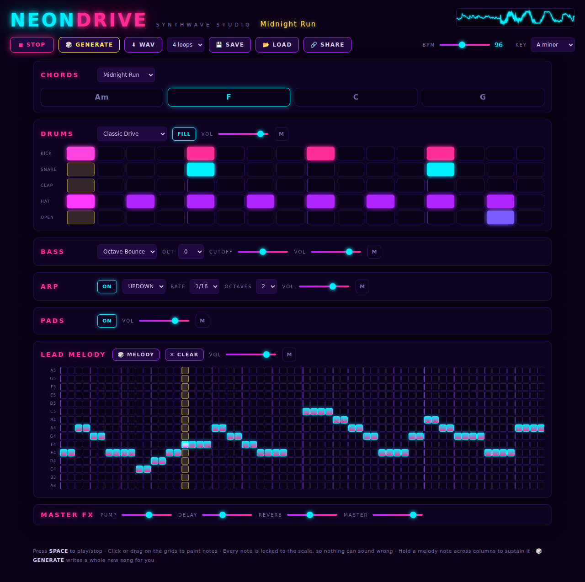

# 🌆 NEON DRIVE — Synthwave Studio

Make **neon drive / synthwave / outrun** music in your browser in seconds.
No installation, no samples, no music theory needed — every sound is
synthesized live with the Web Audio API, and every note is locked to the
scale so nothing you click can sound wrong.



## Run it

Just open `index.html` in any modern browser (Chrome, Edge, Firefox, Safari).

Or serve the folder if you prefer:

```bash
python3 -m http.server 8000
# then open http://localhost:8000
```

## Make a track in 10 seconds

1. Press **▶ PLAY** (or hit `SPACE`) — the built-in demo song starts.
2. Hit **🎲 GENERATE** until you hear something you love. Every press writes a
   complete new song: chords, drums, bass line, arpeggio and melody.
3. Tweak anything — it all updates live.
4. Press **⬇ WAV** to render your track to a `.wav` file you can keep,
   share, or drop into a video.

## What you can control

| Section | What it does |
| --- | --- |
| **CHORDS** | Pick one of 8 classic synthwave progressions in any minor key. The 4 chips show the chords, and everything else follows them automatically. |
| **DRUMS** | A 16-step drum machine with 6 preset grooves (kick, snare, clap, closed/open hats), a gated-reverb 80s snare, and an automatic snare **FILL** at the end of every 4 bars. Click or drag to paint your own beat. |
| **BASS** | 5 bass-line styles (Octave Bounce, Driving 16ths, …) that follow the chords, plus octave and filter-cutoff controls. |
| **ARP** | The classic sparkling synthwave arpeggiator — up / down / up-down / random, 1/8 or 1/16 notes, 1–3 octaves. |
| **PADS** | Warm detuned analog-style chords with slow filter movement underneath everything. |
| **LEAD MELODY** | A piano-roll grid locked to the minor scale. Click to place notes, drag across columns to hold them. **🎲 MELODY** writes a new melody that fits your chords. |
| **MASTER FX** | **PUMP** (sidechain ducking triggered by the kick — the sound of synthwave), dotted-8th ping-pong **DELAY**, **REVERB**, and master volume. |

## Saving & sharing

- Your song **autosaves** in the browser — reload and it's still there.
- **💾 SAVE / 📂 LOAD** — download/restore songs as small `.json` files.
- **🔗 SHARE** — copies a link with the whole song encoded in the URL.
- **⬇ WAV** — renders 1–8 loops offline (identical to what you hear) and
  downloads a 16-bit stereo WAV.

## How it works

- `js/presets.js` — scales, chord progressions, drum grooves, bass styles.
- `js/synth.js` — all instruments synthesized from oscillators & noise:
  analog-style kick, gated-reverb snare, detuned saw bass/lead/pads,
  ping-pong delay, convolution reverb, soft-clip + compressor master bus.
- `js/engine.js` — the 64-step sequencer (4 bars × 16ths), song generator,
  and WAV export via `OfflineAudioContext` (the exact same scheduling code
  renders live playback and the WAV, so they always match).
- `js/ui.js` — the grids, transport, playhead, oscilloscope and persistence.

No dependencies, no build step — plain HTML/CSS/JS.
